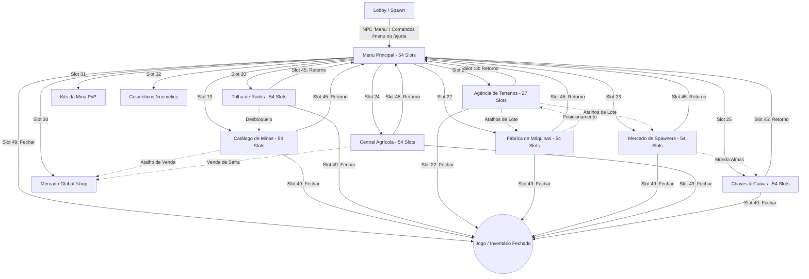

# Arquitetura de Navegação e Fluxo do Usuário (UX) — TW Network

**Versão:** 1.0.0  
**Data:** 05/11/2026  
**Status:** Definitivo / Aprovado  
**Ambiente:** Purpur 26.3 | DeluxeMenus & Ecossistema `tw-*`  

---

## 1. Visão Geral da Arquitetura de Navegação

A experiência do usuário (UX) no servidor **TW Network** foi projetada para formar uma malha interconectada e intuitiva. O jogador não precisa memorizar comandos complexos de chat para transitar entre sistemas de economia, mineração, produção industrial e progressão.

O ecossistema é ancorado no **Hub Central (Menu Principal - `/menu`)**, que atua como o portal primário para os 10 grandes pilares do jogo, complementado por rotas bidirecionais diretas entre sistemas correlatos e botões universais de retorno e fechamento.

---

## 2. Mapa Hierárquico do Ecossistema

```text
                               ┌──────────────────────────────────────────────┐
                               │             MENU PRINCIPAL (HUB)             │
                               │          Comando: /menu ou /ajuda            │
                               │             Capacidade: 54 Slots             │
                               │          Perfil: Slot 4 | Fechar: Slot 49    │
                               └──────────────────────┬───────────────────────┘
                                                      │
         ┌──────────────┬──────────────┬──────────────┼──────────────┬──────────────┬──────────────┐
         │              │              │              │              │              │              │
    ┌────▼────┐    ┌────▼────┐    ┌────▼────┐    ┌────▼────┐    ┌────▼────┐    ┌────▼────┐    ┌────▼────┐
    │  MINAS  │    │  RANKS  │    │TERRENOS │    │MÁQUINAS │    │SPAWNERS │    │  FARMS  │    │ CAIXAS  │
    │54 Slots │    │54 Slots │    │27 Slots │    │54 Slots │    │54 Slots │    │54 Slots │    │54 Slots │
    └────┬────┘    └────┬────┘    └────┬────┘    └────┬────┘    └────┬────┘    └────┬────┘    └────┬────┘
         │              │              │              │              │              │              │
         │         ┌────┴────┐         │              │              │              │         ┌────┴────┐
         ├────────►│ MERCADO │◄────────┼──────────────┼──────────────┼──────────────┼────────►│  FORJA  │
         │         │54 Slots │         │              │              │              │         │27 Slots │
         │         └─────────┘         │              │              │              │         └─────────┘
         │                             │              │              │              │
         │      ┌──────────────────────┴───────┐      │              │              │
         │      │     Sinergia de Terrenos     │◄─────┴──────────────┘              │
         │      │  (Máquinas/Spawners em Lote) │                                    │
         │      └──────────────────────────────┘                                    │
         │                                                                          │
         └─────────────────────── [BOTÃO UNIVERSAL DE RETORNO] ─────────────────────┘
                                  (Slot 45 em 54s | Slot 18 em 27s)
                                                 ▼
                                        Retorna ao Menu Pai
```

---

## 3. Matriz de Integração dos 10 Sistemas Centrais

O Menu Principal (`plugins/DeluxeMenus/gui_menus/menus/menu.yml`, 54 slots) conecta os 10 sistemas prioritários do servidor:

| # | Sistema / Módulo | Ícone Representativo | Slot no Hub | Comando Principal | Submenu / Ação Aberta |
|---|---|---|:---:|---|---|
| **1** | **Mineração Central** | `DIAMOND_PICKAXE` | 19 | `/minaslista` | Catálogo com 16 minas (10 rank, 3 VIP, 3 prestígio). |
| **2** | **Trilha de Ranks** | `NETHER_STAR` | 20 | `/ranks` | Trilha de 11 ranks + 3 prestígios com status de compra. |
| **3** | **Agência de Terrenos**| `GRASS_BLOCK` | 21 | `/terrenos` | Painel de compra de lotes com preço progressivo e teleporte. |
| **4** | **Fábrica de Máquinas** | `FURNACE` | 22 | `/maquinas` | Loja industrial de máquinas geradoras por rank e combustíveis. |
| **5** | **Mercado de Spawners**| `SPAWNER` | 23 | `/spawners` | Loja de geradores de monstros, almas e modo virtual/físico. |
| **6** | **Central Agrícola** | `HAY_BLOCK` | 24 | `/farms` | Silo virtual de colheita, auto-sell e loja de sementes. |
| **7** | **Chaves & Caixas** | `TRIPWIRE_HOOK` | 25 | `/caixas` | Painel de chaves virtuais, roleta, forja de almas e pity. |
| **8** | **Mercado Global** | `EMERALD` | 30 | `/shop` | Loja geral de compra e venda de recursos do servidor. |
| **9** | **Kits de Combate** | `IRON_CHESTPLATE`| 31 | `/kits` | Resgate de kits para a Arena PvP (Básico, VIP, Prestígio). |
| **10**| **Cosméticos Visuais**| `ENDER_EYE` | 32 | `/cosmetics` | Menu de partículas, chapéus, pets e efeitos de lobby. |

### Elementos Especiais no Hub:
- **Slot 4 (Topo Central):** Perfil do Jogador (`head-%player_name%`). Exibe saldo (`%vault_eco_balance_formatted%`), tokens (`%tw_tokens%`), almas (`%tw_souls%`), rank atual (`%tw_rank%`) e grupo de permissões.
- **Slot 48:** Top Magnatas / Ranking dos Mais Ricos (`GOLD_BLOCK` executando `/baltop`).
- **Slot 49 (Rodapé Central):** Botão Universal de Fechamento (`BARRIER` executando `[close]`).
- **Slot 53:** Teleporte Rápido ao Spawn (`ENDER_PEARL` executando `[player] spawn`).

---

## 4. Regras Canônicas de Retorno e Fechamento

Para garantir consistência motora ao jogador, os botões de controle de navegação possuem coordenadas invariáveis:

### 4.1. Botão Universal de Retorno
- **Menus de 54 Slots:** **Slot 45** (primeiro slot da 6ª linha).
  - Material: `ARROW`.
  - Nome: `&e➔ &lVoltar ao Menu`.
  - Ação: `[openguimenu] principal` (no DeluxeMenus) ou redirecionamento ao menu pai correspondente.
- **Menus de 27 Slots:** **Slot 18** (primeiro slot da 3ª linha).
  - Material: `ARROW`.
  - Nome: `&e➔ &lVoltar`.
  - Ação: Retorno ao menu hierarquicamente superior.

### 4.2. Botão Universal de Fechamento
- **Menus de 54 Slots:** **Slot 49** (quinto slot / centro da 6ª linha).
  - Material: `BARRIER`.
  - Nome: `&c➔ &lFechar`.
  - Ação: `[close]`.
- **Menus de 27 Slots:** **Slot 22** (quinto slot / centro da 3ª linha).
  - Material: `BARRIER`.
  - Nome: `&c➔ &lFechar`.
  - Ação: `[close]`.

---

## 5. Rotas Bidirecionais e Sinergias de Gameplay

Além da estrutura radial a partir do Hub, a navegação implementa pontes transversais fundamentadas nas mecânicas de jogo:

### 5.1. Mineração ↔ Mercado Global
- **Problema de UX Clássico:** O minerador enche o inventário ou silo e precisa fechar menus, digitar comandos de chat e reabrir lojas para vender.
- **Solução Bidirecional:**
  - Dentro do menu de minas (`minas.yml`), o jogador tem o comando de teleporte rápido ou atalho direto para o `/shop` ou `/sell all`.
  - No `/shop` (seção de mineração), há um atalho de retorno para `/minaslista`.

### 5.2. Terrenos ↔ Máquinas & Spawners
- **Contexto de Jogo:** Máquinas (`tw-maquinas`) e geradores (`tw-spawners`) só podem ser posicionados fisicamente dentro de lotes no mundo `terrenos`.
- **Solução Bidirecional:**
  - Na Agência de Terrenos (`terrenos.yml`), inclui-se atalhos diretos para `/maquinas` e `/spawners`.
  - Nos menus de máquinas e geradores, inclui-se atalhos para `/terrenos` e `/p home` para fácil acesso à área de construção.

### 5.3. Spawners ↔ Forja de Caixas (Moeda de Almas)
- **Contexto de Jogo:** O abate de mobs em spawners (`tw-spawners`) gera a moeda **Almas (`%tw_souls%`)**. Essa moeda é consumida exclusivamente na Forja de Chaves Divinas do módulo de caixas (`tw-caixas`).
- **Solução Bidirecional:**
  - No menu de spawners (`spawners.yml`), inclui-se um atalho direto para `/key forja` ou `/caixas`.
  - No menu de caixas (`caixas.yml`), a forja de chaves indica a quantidade de almas atual e fornece atalho rápido para `/spawners`.

### 5.4. Agricultura ↔ Silos & Loja Agrícola
- **Contexto de Jogo:** O módulo `tw-farms` gerencia tanto o silo de colheitas (`FarmStorageMenu`) quanto a loja de fertilizantes/sementes (`FarmShopMenu`).
- **Solução Bidirecional:**
  - O menu de farms (`farms.yml`) unifica em uma só interface o status do silo virtual, a ativação do auto-sell e o acesso à loja de fertilizantes e alquimia.

### 5.5. Trilha de Ranks ↔ Catálogo de Minas
- **Contexto de Jogo:** Cada rank adquirido (`/rankup`) desbloqueia uma nova mina no RealMines.
- **Solução Bidirecional:**
  - No menu de ranks (`ranks.yml`), cada rank informa a mina correspondente liberada e possui ação de teleporte imediato após a evolução.
  - No catálogo de minas (`minas.yml`), as minas bloqueadas instruem o jogador a usar `/rankup` e oferecem atalho para a trilha de ranks.

---

## 6. Fluxograma de Transição de Telas (Diagrama Mermaid)



---
*Fim da especificação de Arquitetura de Navegação.*
